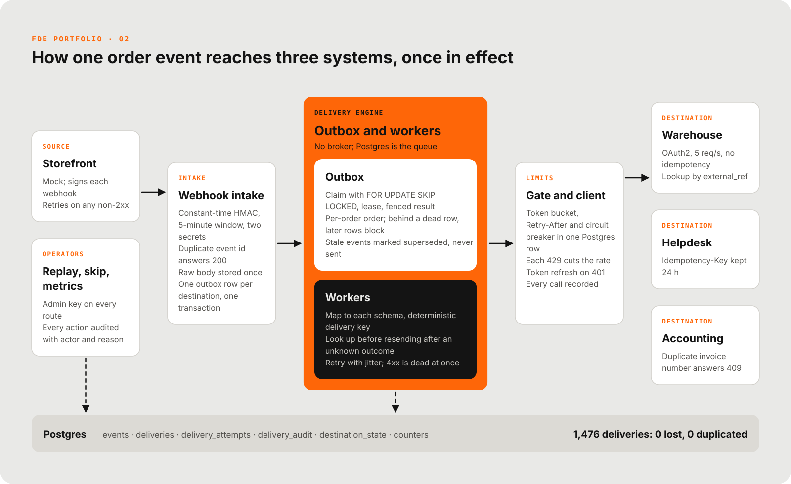
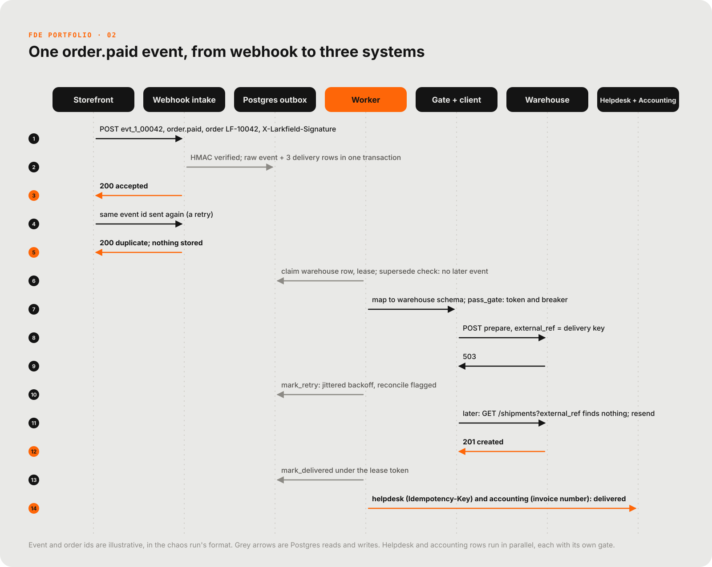

# Larkfield integration hub

Delivers every storefront order event to the warehouse, the helpdesk and the accounting system exactly once in effect, survives outages, and shows what failed and why.

[](docs/media/reel.mp4)
<sub>29-second reel. Click for the full video.</sub>

| Delivered under chaos | Webhook duplicates | Worker kills |
|---|---|---|
| **1,476 deliveries: 0 lost, 0 duplicated, 0 out of order** at the mock providers (`reports/chaos.md`) | **27 of 27 suppressed**, and 5 of 5 forged or stale webhooks rejected (`reports/chaos.md`) | **3 hard kills, 20 leases recovered**, nothing lost (`reports/chaos.md`) |

Zero duplicates is a firm claim for the warehouse, which has no idempotency of its own. It has one stated limit, a slow commit past 13 s, broken on purpose in `reports/chaos-window-probe.md`. See Known limits.

## The problem

Larkfield Coffee Co. is a fictional customer; the storefront and the three destinations are mock providers in this repo (`mocks/`), and no real system is touched. After each order event a script called three APIs directly. When one was slow, rate-limited or down, orders were lost or sent twice, and someone reconciled by hand every Monday. The hub replaces that script (project 2 of the FDE portfolio).

## Architecture



- **Postgres is the queue.** At a few hundred events an hour, one database and a handful of workers is enough, and the outbox row is written in the same transaction as the event.
- **Results are written under a lease token.** A worker that dies before or after sending is recovered by the next claim, and a stale worker cannot overwrite a newer result.
- **Limits live in one Postgres row per destination.** Rate, `Retry-After` and the circuit breaker hold across worker processes, and one slow destination delays only itself.
- **After an unknown outcome the hub looks before it resends.** The warehouse has no idempotency, so a lookup by `external_ref` decides, after a settle delay.
- **A stale event is never sent.** An older event whose later sibling was already delivered is marked `superseded` and audited, rather than moving a destination backwards.

| Piece | Where | What it does |
|---|---|---|
| Webhook intake | `hub/main.py`, `hub/security.py` | Constant-time HMAC over `timestamp.body`, 5-minute window both directions, current and previous secret. Duplicate event id returns 200. Stores the raw body once. |
| Outbox | `hub/outbox.py`, `db/schema.sql` | One row per (event, destination). Claim with `FOR UPDATE SKIP LOCKED`, lease in `next_attempt_at`, results written under a lease token. |
| Ordering | `hub/outbox.py` | A row is claimable only when every earlier row for the same order and destination is settled and no later one is in flight. Behind a dead row, later rows become `blocked` and are never sent. An advisory lock per (order, destination) serialises ingest, dead-lettering, delivery and skip. |
| Stale events | `hub/outbox.py` | An older event whose later sibling was already delivered is `superseded`, never sent. |
| Mapping | `hub/mapping.py` | Pure functions, storefront payload to each destination schema, deterministic delivery key per (event, destination). |
| Gate | `hub/gate.py` | Per-destination token bucket, `Retry-After` block, circuit breaker and adaptive rate (each 429 cuts the rate, successes restore it) in one Postgres row, so limits hold across worker processes. |
| Client | `hub/client.py`, `hub/auth.py` | Token cache with margin and refresh on 401, per-call timeout, classification, every call recorded. A lookup must return a record carrying our key; a 409 is "delivered" only for the duplicate error naming our key. |
| Retry policy | `hub/retry.py`, `hub/worker.py` | Retry 429, 5xx, timeouts and connection errors with equal-jitter exponential backoff up to N counted attempts. 429s and failures while the breaker is open spend no attempts. Other 4xx is dead at once with the response body. |
| Operator tools | `hub/main.py`, `hub/replay.py` | Replay (optionally with a corrected event), skip, both audited with actor and reason. Replay refuses stale helpdesk rows. |
| Observability | `hub/logging_.py`, `GET /metrics` | JSON logs with secret and PII masking. Metrics per destination: delivered, retried, dead, pending, blocked, superseded, skipped, oldest pending age, effective rate, p50 and p95. |

### Exactly once in effect, and where it stops

The hub records success in Postgres under a lease token before it moves on, and never claims a row that is already settled. The destination side is different per system:

| Destination | Mechanism | Remaining window |
|---|---|---|
| Helpdesk | Delivery key sent as `Idempotency-Key`; the provider answers a repeat with the original result for 24 h. | A replay more than 24 hours after the first attempt (refused unless forced). |
| Accounting | Delivery key is the invoice number; a 409 `duplicate_document_number` echoing our key means already booked and counts as delivered. Other 409s are permanent failures. | None by construction. |
| Warehouse | No idempotency. After an ambiguous outcome (timeout, reset, 5xx, lease expired after a worker died, replay) the hub searches `GET /shipments?external_ref=` for a record carrying our key and resends only if there is none. After a timeout or gateway error it waits a settle delay (3 s) first. | **At-least-once window**, see "Known limits". |

Crash windows, all covered by the lease and reconcile path: worker dies before sending (row is re-claimed, nothing was sent); dies after the destination accepted but before the hub recorded it (lease expires, next worker looks up or relies on idempotency); dies after recording (nothing to do).

The chaos verdict fails on any key received twice and on any out-of-order arrival, with no exemption. Doubles that match the window are classified and named in the report, never passed.

## One request, traced



One event becomes three delivery rows, and each is delivered, retried or reconciled independently. Ids in the diagram are illustrative, in the chaos run's format.

## Results

<!-- CHAOS-START -->
Result: **PASS**. Generated 2026-11-09 23:05 UTC by `python -m chaos.run --events 500` (seed 1). Simulated Larkfield Coffee Co. data; all providers are local mocks.

| Metric | Value |
|---|---|
| Events emitted (distinct) | 500 across 257 orders |
| Valid deliveries expected (events x 3 destinations, minus invalid and superseded) | 1476 |
| Lost (count 0 at the mock) | 0 |
| Double-delivered keys / extra copies (counted at the mocks) | 0 / 0 (0 in the documented warehouse window) |
| Ordering violations on any arrival at any mock (copies included) | 0 |
| Wrong order number or action at a mock | 0 |
| Warehouse latency p50 / p95 (webhook received to delivered) | 133.67 s / 274.47 s |
| Helpdesk latency p50 / p95 | 0.67 s / 11.63 s |
| Accounting latency p50 / p95 | 0.24 s / 9.51 s |
| Attempts: HTTP calls to destinations | 2138 (1897 sends, 241 lookups) |
| Retries (delivery cycles beyond the first) | 549 |
| 429s received / Retry-After honoured | 14 / 14 |
| 5xx responses seen by the hub | 437 |
| Timeouts and connection errors seen by the hub | 78 |
| 401s answered by a token refresh | 4 |
| Warehouse requests slow to commit (longer than the 10 s timeout) | 25 |
| Warehouse repeats avoided by lookup (it had landed already) | 60 |
| Accounting and helpdesk repeats absorbed by the destination's own idempotency | 54 (23 accounting 409s, 31 helpdesk key replays) |
| Duplicate webhooks sent / suppressed | 27 / 27 |
| Forged and stale webhooks rejected (401) | 5 of 5 |
| Late events (created sent after paid): superseded / delivered in order | 6 / 3 (of 3 x 3) |
| Hard worker kills / leases recovered afterwards | 3 / 20 |
| Dead letters | 9 (http_422: 3, mapping_error: 6) |
| Blocked behind a dead letter (never sent) | 9 |
| End-to-end latency p50 / p95, all destinations | 1.26 s / 237.39 s |
| Total runtime | 422.9 s |

**Reading these numbers**

- **The double-delivery check only has teeth at the warehouse.** The helpdesk and accounting mocks absorb repeats themselves (54 repeats were absorbed here), so a repeat sent there is invisible at the mock and zero doubles says little about them. The warehouse has no idempotency: every repeat it receives is recorded, and 60 repeats were avoided only because the hub looked the shipment up first.
- **Capacity.** The storefront emits 5 events/s and each event needs at least one warehouse call; the warehouse quota is 5 req/s. The run made 873 warehouse calls (sends, lookups, retries), which needs at least 175 s of quota against 100 s of emission, plus the 60 s outage. The warehouse queue therefore builds by design, and its latency tail is capacity, not a defect.
- **The remaining window.** A repeat can still reach the warehouse if it takes longer than the hub's timeout plus settle delay (10 s + 3 s = 13 s) to commit one request. This run's slow commits take 12 s, inside that bound, so a pass shows the hub covers it. The probe run in `reports/chaos-window-probe.md` breaks the bound on purpose and shows what happens.
- **Never send a stale event.** A row whose order has a later event already delivered at that destination is marked `superseded` and not sent. The remaining limit: a request that is still running inside the destination when the hub gives up cannot be recalled.

Per-destination figures, the settings table, injected-fault counts and every check are in [reports/chaos.md](reports/chaos.md). Counted at the mock providers, not in the hub's tables.
<!-- CHAOS-END -->

Per-destination figures, the settings table, injected-fault counts and every check are in `reports/chaos.md`. `reports/chaos-window-probe.md` is the same run with the warehouse bound broken on purpose.

## How it was tested

- **Chaos run, counted at the destinations.** 500 events across 257 orders, five fault types injected, a 60 s warehouse outage, forged and stale webhooks, duplicates and late events, and 3 hard worker kills. Duplicates, losses, ordering and payload content are read from each mock's own record of accepted requests (`GET /admin/received`), never from the hub's tables.
- **Expected outcomes come from the storefront emitter's manifest.** The verdict logic (`chaos/verify.py`) is itself tested and has no exemption: any key received twice fails the run, and ordering is judged on every arrival.
- **The window probe fails by design.** It breaks the warehouse bound with 25 s commits and reports 5 warehouse keys received twice and 1 order delivered as prepare, release, prepare.
- **What the numbers do not claim.** The double-delivery check only has teeth at the warehouse, because the helpdesk and accounting mocks absorb repeats themselves. The run is one seed on mock providers, and the warehouse latency tail is capacity, not a defect.

## Run it

Needs the project venv (Python 3.13 with fastapi, uvicorn, httpx, psycopg, pydantic-settings, pytest, ruff) and Docker for Postgres. Commands from the project root.

```
cp .env.example .env                         # then change every value; docker compose reads HUB_DB_PASSWORD from it
docker compose up -d db                      # Postgres on 127.0.0.1:5434, schema applied on first start
python -m mocks                              # mock providers on 9000 (reads MOCK_* from .env)
python -m hub                                # hub on 8100 with embedded workers
python -m hub.worker --workers 4             # optional: more workers, another process
python -m chaos.run --events 500             # end-to-end chaos test, writes reports/chaos.md
python -m chaos.run --events 500 --probe     # breaks the documented bound on purpose (expected to fail)
python -m pytest -q                          # unit and database tests (DB tests need the compose Postgres)
python -m ruff check .
```

Use `python -m hub`, not `uvicorn hub.main:app`: async psycopg needs the selector event loop, which the launcher sets up on Windows.

Try it by hand:

```
curl -H "X-Admin-Key: $HUB_ADMIN_KEY" "localhost:8100/deliveries?status=dead"
curl -H "X-Admin-Key: $HUB_ADMIN_KEY" "localhost:8100/deliveries?status=blocked"
curl -H "X-Admin-Key: $HUB_ADMIN_KEY" localhost:8100/metrics
curl -X POST -H "X-Admin-Key: $HUB_ADMIN_KEY" localhost:8100/deliveries/42/replay
curl -X POST -H "X-Admin-Key: $HUB_ADMIN_KEY" -H "Content-Type: application/json" \
     -d '{"reason": "invoice raised by hand"}' localhost:8100/deliveries/42/skip
python -m hub.replay --destination warehouse --since 2026-11-10T00:00:00Z --dry-run
```

Mock providers: `GET/PUT /admin/faults` (error rate, latency, outage, accept-then-timeout, slow commit, lost response, rate limit), `GET /admin/received` (every accepted request, in arrival order), `POST /storefront/emit`. All `/admin/*` and storefront control routes need `X-Admin-Key`.

### HTTP surface

| Route | Auth | Purpose |
|---|---|---|
| `POST /webhooks/storefront` | HMAC | Intake. 401 bad signature or timestamp, 400 malformed, 413 too large, 200 accepted or duplicate. |
| `GET /deliveries?status=&destination=&since=` | admin key | Statuses: pending, in_flight, delivered, dead, blocked, superseded, skipped. |
| `GET /deliveries/{id}` | admin key | Delivery, the full attempt log and the audit log. |
| `POST /deliveries/{id}/replay` | admin key | Dead rows only; body optional: `corrected_event`, `reason`, `force`. 409 otherwise, and for stale helpdesk rows. |
| `POST /deliveries/{id}/skip` | admin key | Dead rows only; `reason` required. Releases the rows blocked behind it. |
| `GET /metrics` | admin key | Per-destination counts, oldest pending age, effective rate, p50 and p95 delivery latency. |
| `GET /healthz` | none | Database reachable. |

## Repository layout

| Path | Contents |
|---|---|
| `hub/` | The hub: API, outbox, workers, gate, client, mapping, replay CLI |
| `mocks/` | Mock storefront, warehouse, helpdesk, accounting; fault injection |
| `chaos/` | Chaos runner and the verdict logic (`verify.py`, itself tested) |
| `tests/` | Unit tests plus database and worker tests against a throwaway `hub_test` database |
| `db/schema.sql` | Schema |
| `docs/` | `spec.md`, `runbook.md`, `engagement.md`; `diagrams/` (YAML specs and rendered SVG), `media/` (reel) |
| `reports/` | `chaos.md` (last chaos run), `chaos-window-probe.md` (the bound broken on purpose) |

## Known limits

- **Warehouse window.** The warehouse has no idempotency. If it needs longer than the hub's client timeout plus settle delay (10 s + 3 s) to commit one request, the hub's lookup finds nothing, the hub resends, and the original lands later: a repeat and, if a cancel went in between, `prepare` after `cancel`. The hub cannot close this (no fence at the destination). The chaos run keeps its slow commits inside the bound and passes; [reports/chaos-window-probe.md](reports/chaos-window-probe.md) breaks the bound on purpose (25 s commits) and shows what the window produces: in the last probe, 5 warehouse keys received twice (5 extra copies) and 1 order delivered as prepare, release, prepare. That run fails by design.
- **Late events are dropped, not delayed.** If an older event for an order arrives after a newer one was already delivered to a destination, it is marked `superseded` (audited, in `/metrics`) and never sent. A late `order.created` after `order.paid` therefore never reaches that destination.
- **A request already running inside a destination cannot be recalled.** Any guarantee here is about what the hub sends, not about requests it has given up on.
- **Helpdesk replays older than 24 h are refused** unless forced: the provider forgot the idempotency key.
- **Ordering assumes** the storefront sends one order's events sequentially; the order is taken from the event's `created_at`, then arrival.
- Raw events (customer contact details included) are stored as received. Logs mask emails and phone numbers; the database does not. Set a retention policy.
- Postgres listens on `127.0.0.1` only, with the password from `.env`. The hub refuses to start without `HUB_DATABASE_URL` and `HUB_WEBHOOK_SECRETS`.
- Credentials are read at start-up; rotate by restarting (see `docs/runbook.md`).
- The hub runs on a selector event loop; the mocks and the chaos runner do not need it.

## How this was built

Built with Claude Code as a pair programmer. Scope, design decisions and verification are mine. Larkfield Coffee Co. is a fictional customer; all data is synthetic. MIT licensed (see `LICENSE`).

<!-- signature -->
<p align="center"><br><sub>Signature GIF: <a href="https://commons.wikimedia.org/wiki/File:How_dogs_drink.gif">A dog drinking water in slow motion</a> by Craybabes, CC BY-SA 4.0, via Wikimedia Commons.</sub></p>
